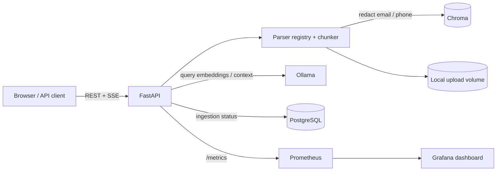

# DocEnquire

DocEnquire is a local-first document question-answering service. It parses PDF, DOCX,
PPTX, XLSX, HTML, Markdown, and plain-text files; indexes chunks in Chroma; and answers
questions with source citations using Ollama.

## Architecture



In local development Chroma persists to disk and PostgreSQL is optional. Docker Compose
uses the Chroma server and PostgreSQL services. Ollama runs locally or in Compose; model
weights are persisted separately from indexed documents.

## Run locally

Requirements: Python 3.11+, Ollama, and the models configured below.

```powershell
python -m pip install -e ".[dev]"
ollama pull gemma2:2b
ollama pull nomic-embed-text
Copy-Item .env.example .env
uvicorn src.main:app --reload
```

The API is available at `http://localhost:8000`; OpenAPI docs are at `/docs`.
Set `RAG_OLLAMA_BASE_URL` when Ollama is not listening on localhost. Leave
`RAG_DATABASE_URL` and `RAG_CHROMA_HOST` empty for the local-file development mode.

## Docker Compose

```powershell
docker compose up --build -d
docker compose exec ollama ollama pull gemma2:2b
docker compose exec ollama ollama pull nomic-embed-text
```

Services: API `:8000`, Grafana `:3000`, Prometheus `:9090`, plus internal Chroma,
Ollama, and PostgreSQL. Grafana's provisioned dashboard is named **DocEnquire service
health**. For real deployments, replace the example PostgreSQL credentials, restrict
published ports, configure authentication/TLS, and manage secrets outside Compose.

To disable container egress after downloading and persisting the model weights, use
the internal-only network overlay:

```powershell
docker compose -f docker-compose.yml -f docker-compose.no-egress.yml up --build -d
```

This prevents Compose services from reaching external networks; it does not prevent
access to services on the same internal network. It also means Ollama cannot download
models while the overlay is active. The no-egress configuration is provided, but has
not been executed in this development environment.

## API and data flow

- `POST /api/v1/documents/upload` parses, redacts, chunks, embeds, and indexes a file.
- `GET /api/v1/documents/` lists indexed documents.
- `DELETE /api/v1/documents/{document_id}` removes a document and its chunks.
- `POST /api/v1/query/` answers a question and includes citation/source metadata.
- `POST /api/v1/query/stream` streams answer tokens and citations over SSE.
- `GET /api/v1/health/` reports service/vector-store counts.
- `GET /metrics` exposes Prometheus counters and histograms.

Email addresses and phone numbers are redacted from extracted segment text and query
text before chunking, embedding, retrieval, and LLM prompting. Original uploads remain
in the configured local upload volume; redaction is not a substitute for access
controls, retention limits, or secure storage. Sources
returned with answers retain file and location metadata so users can verify claims.
Re-ingest or rebuild collections created before redaction was enabled; this setting
does not sanitize existing vector records.

With `RAG_DATABASE_URL` configured, PostgreSQL records content hash, collection,
document ID, attempt count, error, and `queued` / `processing` / `indexed` / `failed`
status. Re-uploading identical bytes to the same collection reuses the stable document
ID and does not create another logical document. Failed content can be retried by
re-uploading it; embedding/index writes are retried up to three times. Without
PostgreSQL, the app continues to work locally but does not provide durable job status.
An interrupted `processing` record becomes eligible for re-ingestion after 30 minutes.

## Observability

The API exports:

| Metric | Meaning |
|---|---|
| `rag_http_requests_total` | Request count by method, route, and status |
| `rag_http_errors_total` | Error responses and streamed-query failures |
| `rag_http_request_duration_seconds` | Request duration histogram |
| `rag_time_to_first_token_seconds` | Stream start to first generated token |
| `rag_ingestion_failures_total` | Failed ingestion count |

Request logs are JSON and include an `X-Request-ID` correlation value. Route templates
are used as metric labels to avoid per-document identifier cardinality. The dashboard
shows traffic, errors, p95 request latency, p95 time to first token, and ingestion
failures.

The dashboard definition is provisioned at
[`observability/grafana/dashboards/docenquire.json`](./observability/grafana/dashboards/docenquire.json).
A live screenshot is not included yet because the Docker engine was unavailable to
start Grafana during the initial implementation. The evaluation runbook lists the
dashboard panels to populate and capture.

## Evaluation status

No evaluation score is claimed yet. This checkout now contains a self-authored
synthetic 16-document corpus and 56 manually authored questions, but no human-reviewed
labels or completed before/after model run. Scores must be collected against the
provided corpus and pinned model versions; generating results without that run would
be misleading.

The evaluation runner is at [evaluation/evaluate.py](./evaluation/evaluate.py). A
JSONL question row contains `id`, `question`, `relevant_document_ids`, and
`unanswerable`; optional `collection_name` and `top_k` override run defaults. It
requires 50–60 questions and at least 12 unanswerable cases, writes raw answer/source
records, and computes retrieval hit rate and abstention. After manually checking
answers, add boolean `human_answer_correct` and
`human_contains_unsupported_claims` labels to at least 20 records and rerun with
`--score <run.json>` to calculate human-reviewed accuracy and hallucination rate.
Run baseline and changed configurations separately with `--label` and `--change`.

The self-authored synthetic corpus contains 16 ready-to-upload documents across the
seven supported formats, with a matching 56-question JSONL set (12 unanswerable).
Recreate it with [evaluation/create_corpus.py](./evaluation/create_corpus.py), upload
the files with [evaluation/upload_corpus.py](./evaluation/upload_corpus.py), and
follow the [evaluation runbook](./evaluation/RUNBOOK.md) for exact commands, human
labeling, comparison, and evidence capture. The files are generated for this project
and contain no real organizational material or personal data.

Recommended report format for the completed run:

| Configuration | Retrieval hit rate@5 | Answer accuracy (human-reviewed) | Hallucination rate (human-reviewed) | Unanswerable abstention |
|---|---:|---:|---:|---:|
| Baseline | Not measured | Not measured | Not measured | Not measured |
| Changed chunk size or prompt | Not measured | Not measured | Not measured | Not measured |

Use 50–60 questions with at least 12 unanswerable cases, label at least 20 outputs,
and compare any automated judge against those human labels. Preserve the corpus
license, question set, model/version, prompt, and run output with the report. Report
limitations alongside scores (especially corpus size, parser coverage, and judge
agreement).

## Design decisions and trade-offs

- **Chroma + Ollama:** local inference and vector storage avoid sending documents to a
  hosted model by default. Local operation trades throughput and availability for
  data locality.
- **PostgreSQL job catalog:** content hashes and stable IDs make ingestion repeatable.
  The current API still processes uploads inline; a durable asynchronous queue would
  be the next step for large or bursty workloads.
- **Regex PII redaction:** inexpensive and dependency-free, but not comprehensive.
  False negatives are possible for international or irregularly formatted phone
  numbers; evaluate a dedicated recognizer for sensitive deployments.
- **Citations:** retrieved chunks and structural parser metadata provide source
  traceability, but citations do not guarantee that generated claims are entailed by
  those sources.
- **No-egress Compose overlay:** blocks outbound container networking, not local
  administrator access, host networking, or malicious host-level changes.

## Failure modes and scaling

Unavailable Ollama/Chroma/PostgreSQL services prevent corresponding requests from
completing. Parse and embedding errors mark ingestion failed; re-upload can retry it.
If indexing succeeds but PostgreSQL status update fails, the vector write may exist
while the job status is stale; reconcile by content hash before operating at scale.
For higher load, move parsing/embedding to a durable worker queue, use object storage
with retention policies, add authentication and tenant isolation, use PostgreSQL
transactions/outbox semantics, and add traces plus alerting for latency and failures.

## Development

```powershell
ruff check src tests
pytest -q
```

GitHub Actions runs lint and tests on pushes and pull requests. Tests do not require
live Ollama, Chroma, or PostgreSQL services.
